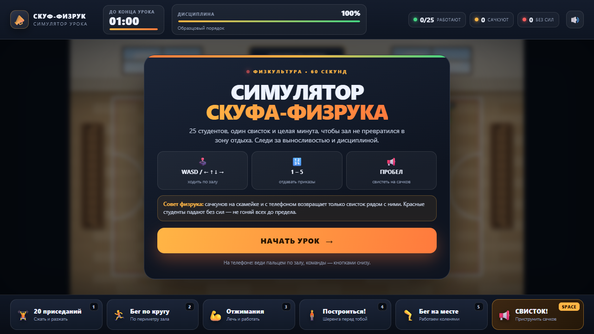
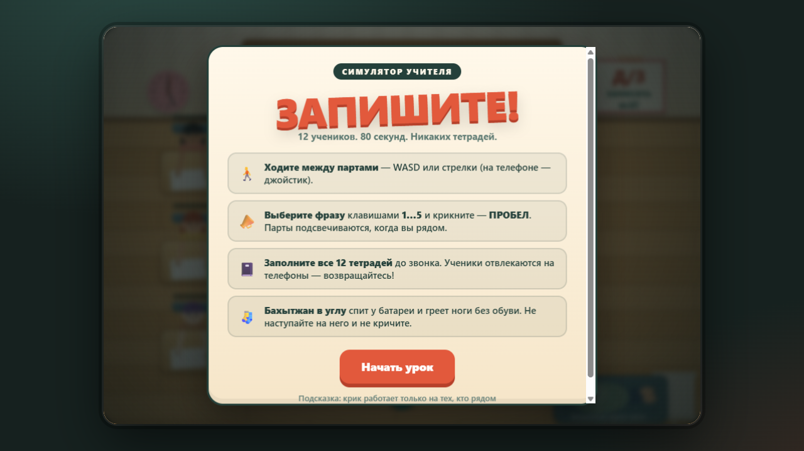
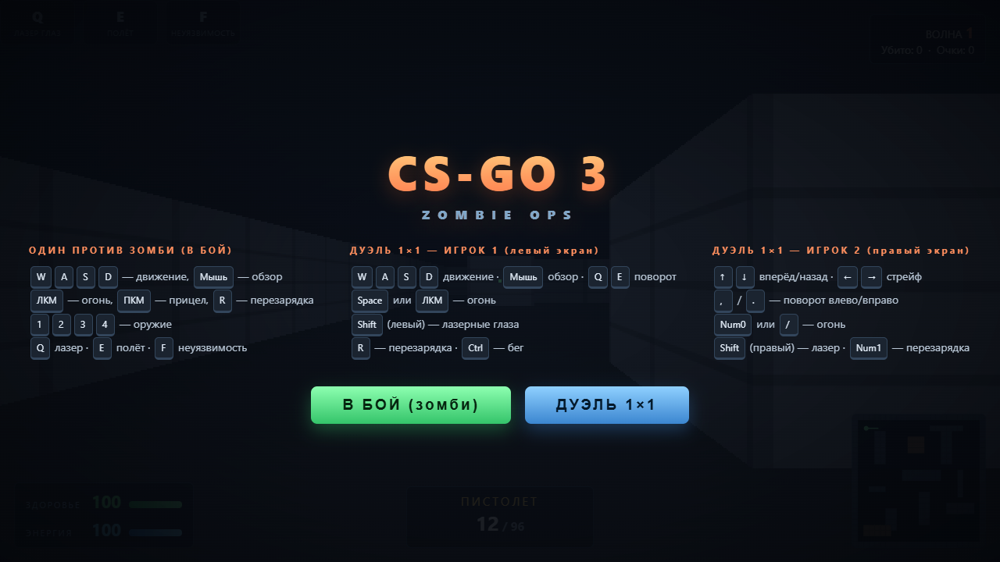

# 🎮 Сборник студенческих веб-игр | Astana Polytechnic

<div align="center">


### **Высший колледж «Astana Polytechnic»**
*Коллекция оригинальных браузерных инди-игр, созданных студентами*

---

</div>

## 📌 О проекте

В данном репозитории собраны 3 полностью самодостаточные браузерные игры на чистом стеке **HTML5 / Canvas / JavaScript / CSS3**. 
Все игры работают прямо в любом современном браузере без необходимости устанавливать дополнительные зависимости, плагины или веб-серверы — достаточно просто открыть соответствующий `.html` файл!

---

## 👥 Авторы и создатели

| Игра | Идея / Геймдизайн | Реализация / Код |
| :--- | :--- | :--- |
| **Симулятор Скуфа-Физрука** | **Кирилл Акиншин** | **Кирилл Акиншин** |
| **ЗАПИШИТЕ! (Симулятор учителя)** | **Кирилл Акиншин** | **Влад Евполов** |
| **CS-GO 3: Zombie Ops** | **Влад Евполов** | **Влад Евполов** |

---

## 🕹️ Обзор игр

### 1. 📣 Симулятор Скуфа-Физрука
> **Файл:** [`skuf-fizruk.html`](./skuf-fizruk.html)  
> **Автор:** Кирилл Акиншин  
> **Жанр:** 2D Аркадный тайм-менеджмент / Симулятор школьного спортзала



#### 📖 Про что игра:
Вы играете за сурового физрука советской закалки. У вас в спортзале **25 непослушных студентов** и ровно **60 секунд** урока физкультуры. Ваша задача — поддерживать железную дисциплину, гонять сачков и не дать уроку скатиться в хаос.

Студенты норовят присесть на лавочку, залипнуть в смартфон или разбежаться по углам. Однако перегибать палку тоже нельзя — от чрезмерных нагрузок студенты теряют выносливость и падают без сил!

#### 🎮 Управление:
* `W` `A` `S` `D` или `Стрелочки` — передвижение физрука по залу
* `1` — Команда «20 приседаний»
* `2` — Команда «Бег по кругу»
* `3` — Команда «Отжимания»
* `4` — Команда «Построиться в шеренгу!»
* `5` — Команда «Бег на месте»
* `ПРОБЕЛ` — **СВИСТОК!** (приструнить сачков рядом с вами и вернуть их к упражнениям)
* Поддерживается сенсорное управление для мобильных экранов.

---

### 2. 📓 ЗАПИШИТЕ! — Симулятор учителя
> **Файл:** [`записывайте.html`](./записывайте.html)  
> **Идея:** Кирилл Акиншин | **Реализация:** Влад Евполов  
> **Жанр:** Классный стелс-менеджмент / Ироничный симулятор урока



#### 📖 Про что игра:
Атмосферный симулятор преподавателя колледжа / школы. В кабинете сидят **12 студентов**, и у вас есть **80 секунд**, чтобы заставить каждого заполнить конспекты в своих тетрадях до финального звонка.

Студенты постоянно отвлекаются, достают смартфоны и забивают на учёбу. Преподавателю нужно курсировать между рядами парт, выбирать правильные коронные преподавательские фразы и кричать их на отвлекающихся учеников.

> ⚠️ **Особое внимание:** В углу у батареи сладко спит студент **Бахытжан** без обуви и греет ноги. Трогать и будить Бахытжана категорически не рекомендуется!

#### 🎮 Управление:
* `W` `A` `S` `D` / `Стрелочки` — ходить между партами (на мобильных — виртуальный стик)
* `1` … `5` — переключение преподавательских реплик
* `ПРОБЕЛ` — крикнуть выбранную фразу (действует в радиусе вокруг преподавателя)
* `P` или `Esc` — пауза / перемена
* `M` — вкл/выкл звук

---

### 3. 🧟 CS-GO 3: Zombie Ops (с суперсилами Хоумлендера)
> **Файл:** [`контр страйк 3.html`](./контр страйк 3.html)  
> **Автор:** Влад Евполов  
> **Жанр:** 3D Псевдо-рейкастинг FPS / Арена-шутер с суперспособностями



#### 📖 Про что игра:
Шутер от первого лица с олдскульной псевдо-3D графикой в духе классических Wolfenstein / DOOM и механиками Counter-Strike, помноженными на разрушительные сверхспособности **Хоумлендера (Homelander)** из сериала «Пацаны» (*The Boys*).

Противостойте волнам свирепых зомби, накапливайте энергию, комбинируйте огнестрельный арсенал и суперсилы. В игре также реализован **режим локальной дуэли 1 на 1 со сплит-скрином (Split Screen)** за одной клавиатурой!

#### ⚡ Суперспособности Хоумлендера:
* **Лазерные глаза (`Q` / `Shift`)** — прожигают плотные ряды мутантов насквозь тепловыми лучами из глаз.
* **Полёт (`E`)** — парение над землёй, позволяющее уйти от окружения.
* **Неуязвимость (`F`)** — временный абсолютный щит, поглощающий любой урон.

#### 🎮 Управление (Одиночный режим против зомби):
* `W` `A` `S` `D` — движение бойца
* `Мышь` — круговой обзор и прицеливание
* `ЛКМ` — стрельба из оружия
* `ПКМ` — оптический прицел
* `R` — перезарядка магазина
* `1` `2` `3` `4` — выбор оружия из арсенала
* `Q`, `E`, `F` — суперсилы Хоумлендера

#### ⚔️ Режим Дуэли 1×1 (Split Screen за одним ПК):
* **Игрок 1 (Левый экран):** `W` `A` `S` `D` + Мышь (или `Q`/`E` для поворота), огонь — `Пробел` или `ЛКМ`, лазер — левый `Shift`, перезарядка — `R`.
* **Игрок 2 (Правый экран):** `↑` `↓` ход, `←` `→` стрейф, `,` и `.` поворот, огонь — `Num 0` или `/`, лазер — правый `Shift`, перезарядка — `Num 1`.

---

## 🚀 Как запустить игры

1. Скачайте или клонируйте репозиторий:
   ```bash
   git clone https://github.com/your-username/games-backup.git
   ```
2. Откройте любой из файлов двойным щелчком мыши в любимом браузере (*Google Chrome, Microsoft Edge, Mozilla Firefox, Safari, Яндекс.Браузер*):
   * `skuf-fizruk.html`
   * `записывайте.html`
   * `контр страйк 3.html`
3. Играйте и ставьте рекорды!

---

<div align="center">

Сделано с душой студентами **Astana Polytechnic** 🎓

</div>
