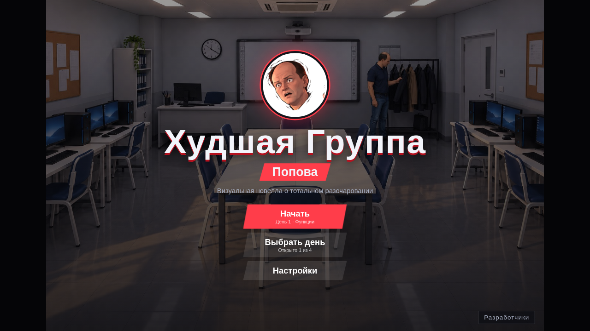
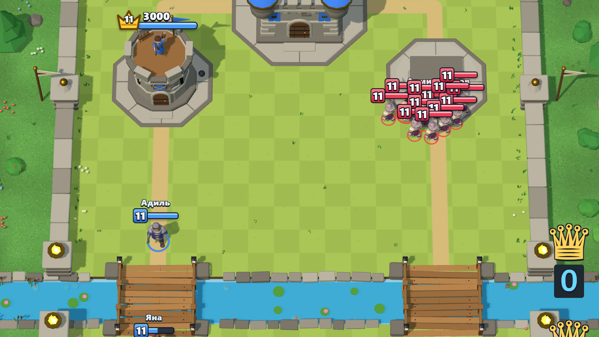

# 🎮 Polytech Games — игры Astana Polytechnic

<div align="center">
  

Браузерные игры, навайбкоженные студентами группы **П-24-67Б**.
Пары, физра, зомби и легендарная группа Попова.

**[▶ Играть на GitHub Pages](https://skippingclass.github.io/PolytechGamesBackup/)** · [Добавить игру или исправление](./CONTRIBUTING.md)
</div>

## Быстрый запуск

Открой [каталог на GitHub Pages](https://skippingclass.github.io/PolytechGamesBackup/) и выбери игру — установка не нужна.

Для локального запуска скачай репозиторий через **Code → Download ZIP**, распакуй архив и открой корневой `index.html` в браузере. Или клонируй проект:

```bash
git clone https://github.com/skippingclass/PolytechGamesBackup.git
cd PolytechGamesBackup
```

После этого открой `index.html`. Сборка, npm и сервер для обычного запуска не требуются. Игры написаны на HTML, CSS и JavaScript; графика использует Canvas и DOM. Для шутера нужны клавиатура, мышь и захват указателя браузером.

## Авторы и разработчики

- [Владислав Евполов (@skippingclass)](https://github.com/skippingclass)
- [Кирилл Акиншин (@AKDWorks)](https://github.com/AKDWorks)
- [Камиль Нурмагамбетов (@miilxxwizi)](https://github.com/miilxxwizi)

| Игра | Идея / геймдизайн | Реализация / код |
| --- | --- | --- |
| [Симулятор Скуфа-Физрука](./games/skuf-fizruk.html) | [Кирилл Акиншин (@AKDWorks)](https://github.com/AKDWorks) | [Кирилл Акиншин (@AKDWorks)](https://github.com/AKDWorks), DeepSeek v4.1 Flash |
| [ЗАПИШИТЕ!](./games/записывайте.html) | [Кирилл Акиншин (@AKDWorks)](https://github.com/AKDWorks) | [Владислав Евполов (@skippingclass)](https://github.com/skippingclass), DeepSeek v4.1 Flash |
| [CS-GO 3: Zombie Ops](./games/контр%20страйк%203.html) | [Владислав Евполов (@skippingclass)](https://github.com/skippingclass) | [Владислав Евполов (@skippingclass)](https://github.com/skippingclass), DeepSeek v4.1 Flash |
| [Худшая Группа Попова](./games/popov/index.html) | [Кирилл Акиншин (@AKDWorks)](https://github.com/AKDWorks), ChatGPT | [Камиль Нурмагамбетов (@miilxxwizi)](https://github.com/miilxxwizi), Claude |
| [Жан на грани](./games/zhan-na-grani/index.html) | [Кирилл Акиншин (@AKDWorks)](https://github.com/AKDWorks), ChatGPT | [Кирилл Акиншин (@AKDWorks)](https://github.com/AKDWorks), Claude |
| [Политех Рояль](https://polytechnic-royale.vercel.app/) | [Камиль Нурмагамбетов (@miilxxwizi)](https://github.com/miilxxwizi) | [Камиль Нурмагамбетов (@miilxxwizi)](https://github.com/miilxxwizi), Claude |

## Игры и управление

Из меню паузы каждой игры кнопка **«К списку игр»** возвращает в каталог. «Политех Рояль» открывается на своём сайте — оттуда в каталог возвращает кнопка браузера «Назад».

В каталоге две полки. **VIP** — сюжетные «Худшая Группа Попова», «Жан на грани» и карточная PvP-стратегия «Политех Рояль». **Обычные** — короткие «ЗАПИШИТЕ!», «Симулятор Скуфа-Физрука» и «CS-GO 3: Zombie Ops».

### 👨‍🏫 Худшая Группа Попова



Веди пары по JavaScript у Д.В. Попова: вызывай студентов, выбирай сложность вопросов и реагируй на случайные события. На день запланированы 3–4 события: первое — перед первым вопросом, остальные — через 2–3 вопроса. До конца дня событие остаётся доступным, пока не отреагируешь или не закроешь его крестиком. Ответы учитывают сложность и навык студента; компенсация случайности сглаживает длинные серии. Цель — заполнить шкалу ошеломления преподавателя. Настройки и прогресс сохраняются в браузере.

<details>
<summary>Управление</summary>

- Клик, `Пробел` или `Enter` — продолжить диалог; клик по варианту — сделать выбор.
- `1`–`9` — выбрать доступный вариант или карточку по номеру.
- `Tab` / «↻ Ракурс» — сменить ракурс аудитории.
- `Ctrl` — промотка; `AUTO` — авточтение.
- `L` / `LOG` — история реплик; `Esc` — открыть или закрыть игровое меню во время игры.

</details>

### 💦 Жан на грани


Одна пара, три друга и предел терпения Жана. Чередуй пакости Влада, Адиля и Кирилла, набери 100 веселья до звонка в 14:20 и не доведи Жана до жалобы. Если он закипает, угости его — терпение вернётся.

<details>
<summary>Управление</summary>

- Клик, `Пробел` или `Enter` — продолжить диалог.
- `1` / `2` / `3` или клик по карточке — пакость Влада, Адиля или Кирилла.
- Водяной пистолет: целься мышью и кликай; попадание в шею даёт больше всего очков.
- Ноутбук: держи `Пробел` или кнопку мыши и отпусти, когда Жан оглядывается.
- Фото: клик или `Пробел`, когда у Жана смешное лицо.
- `T` — угостить Жана.
- `Esc` или ⏸ — пауза, настройки и выход к списку игр.

</details>

### 👑 Политех Рояль



Карточные бои один на один в реальном времени. Собери колоду из восьми карт — одногруппники, преподаватели, «Армия Жанов», «Linux Ракета» и «1С Шар», — и за три минуты снеси башни соперника; последняя минута идёт с двойным эликсиром. Играй с ботом или создай комнату и позови друга по коду: браузеры соединяются напрямую. Войди в Политех ID, чтобы получать трофеи за матчи и попасть в таблицу лидеров.

Игра размещена отдельно, на [polytechnic-royale.vercel.app](https://polytechnic-royale.vercel.app/): аккаунтам Политех ID нужен сервер, а комнатам по коду — интернет. Карточка в каталоге ведёт туда. Интерфейс рассчитан на сенсорный экран (iPad), работает и мышью.

<details>
<summary>Управление</summary>

- «Карты» — колода и коллекция; «Случайные карты» собирают колоду за одно касание. В бой можно только с полной колодой.
- «Игра с ботом» — тренировка без трофеев; «Создать комнату» даёт код из пяти символов, второй игрок вводит его и нажимает «Войти». Ссылка вида `?code=КОД` сразу подключает к комнате.
- Касание карты в руке, затем касание клетки на своей половине поля — или перетащи карту на поле. Заклинания и шахтёр ставятся в любую точку.
- 💬 — эмоции; ‹ — выйти из боя.

</details>

### 📓 ЗАПИШИТЕ! — симулятор учителя


За 100 секунд заставь 12 студентов заполнить тетради. Ходи между партами, выбирай преподавательские реплики и возвращай отвлёкшихся к конспектам. Бахытжана у батареи лучше не будить.

<details>
<summary>Управление</summary>

- `WASD` / стрелки — движение; на телефоне — виртуальный стик.
- `1`–`5` — выбрать реплику; `Пробел` — крикнуть её рядом со студентами.
- `P` / `Esc` / ⏸ — пауза; `M` — переключить звук.
- На телефоне для крика и выбора реплик есть экранные кнопки.

</details>

### 📣 Симулятор Скуфа-Физрука


Удержи дисциплину среди 25 студентов за минуту урока. Отдавай команды и свисти на сачков поблизости, но следи за выносливостью: перегруженные студенты падают без сил.

<details>
<summary>Управление</summary>

- `WASD` / стрелки — движение; на телефоне — веди пальцем по залу.
- `1` — приседания, `2` — бег по кругу, `3` — отжимания, `4` — построение, `5` — бег на месте.
- `Пробел` — свисток; команды также доступны кнопками под игровым полем.
- `Esc` / `P` / ⏸ — пауза; `M` — переключить звук.

</details>

### 🧟 CS-GO 3: Zombie Ops


Отбивай волны зомби оружием и суперсилами Хоумлендера: лазером, полётом и неуязвимостью. Или устрой локальную дуэль 1×1 с разделённым экраном за одной клавиатурой.

<details>
<summary>Управление и дуэль</summary>

В одиночной игре:

- `WASD` — движение, мышь — обзор, `ЛКМ` — огонь, `ПКМ` — прицел.
- `R` — перезарядка; `1`–`4` — оружие.
- `Q` — лазер, `E` — полёт, `F` — неуязвимость.
- `Esc` — освободить указатель и открыть паузу. Для продолжения нажми «ПРОДОЛЖИТЬ».

В дуэли:

| Действие | Игрок 1 — левый экран | Игрок 2 — правый экран |
| --- | --- | --- |
| Движение | `WASD` | Стрелки |
| Поворот | Мышь / `Q`, `E` | `,`, `.` |
| Огонь | `Пробел` / `ЛКМ` | `Num 0` / `/` |
| Лазер | Левый `Shift` | Правый `Shift` |
| Перезарядка | `R` | `Num 1` |

`Esc` открывает паузу для обоих игроков.

</details>

## Структура проекта

```text
index.html                  # Каталог игр, точка входа GitHub Pages
assets/                     # Общие ресурсы
screenshots/                # Изображения для каталога и README
games/
├── skuf-fizruk.html         # Физрук: разметка, стили и логика в одном файле
├── записывайте.html         # Симулятор учителя
├── контр страйк 3.html      # Шутер и локальная дуэль
├── zhan-na-grani/
│   ├── index.html          # Готовая автономная игра, картинки встроены
│   ├── dev.html            # Проверка сборки с внешними картинками
│   ├── src/                # Код игры, стили, HTML и отдельно движок
│   ├── assets/             # Именованные изображения
│   └── tools/build.py      # Сборка на Python без npm
└── popov/
    ├── index.html          # Разметка новеллы
    ├── game.js             # Логика и интерфейс
    ├── data.js             # Сценарий, вопросы и события
    ├── style.css           # Стили
    ├── assets/             # Исходные изображения; assets/game/ — сжатые WebP
    ├── tools/              # Подготовка ресурсов
    └── GDD.md              # Дизайн-документ
tests/                      # Проверки паузы, ресурсов и браузерных сценариев
tools/ci-checks.example.yml # Готовый шаблон GitHub Actions
CONTRIBUTING.md             # Инструкция для участников и ИИ-агентов
```

Хочешь пополнить сборник или поправить баг? Начни с [CONTRIBUTING.md](./CONTRIBUTING.md).

## Проверки для разработчиков

Для игры установка инструментов по-прежнему не нужна. Автоматические проверки требуют Node.js 22+ и Python 3:

```bash
node --test games/popov/tests/*.test.cjs tests/*.test.cjs
```

Проверяются баланс и события «Попова», остановка текста и таймеров в меню, AUTO, блокировка Ctrl в паузе, синтаксис JavaScript, локальные ссылки, игровые ресурсы и соответствие сборки «Жана» исходникам.

Браузерные проверки используют отдельный необязательный инструмент Playwright и Chromium. Например, на Linux:

```bash
npm install --prefix /tmp/polytech-browser playwright-core@1.64.1
/tmp/polytech-browser/node_modules/.bin/playwright-core install chromium
PLAYWRIGHT_MODULE=/tmp/polytech-browser/node_modules/playwright-core node tests/browser.cjs
```

Если Chromium уже установлен, можно задать `CHROMIUM_PATH=/путь/к/chromium`. Браузерная проверка запускает каталог и пять игр через `file://` и HTTP в подпапке, проверяет паузу, продолжение, перезапуск, выход в каталог и мобильную раскладку «Попова». HTTP-сервер запускается и закрывается самим тестом. Для GitHub Actions подготовлен [шаблон](./tools/ci-checks.example.yml). Чтобы включить CI, помести его в `.github/workflows/checks.yml` и отправь с токеном, у которого есть право `workflow`, либо через интерфейс GitHub. Текущий OAuth-токен не разрешает создавать workflow, поэтому шаблон пока не активирован.

Как изменять и пересобирать «Жана» — в [инструкции игры](./games/zhan-na-grani/DEVELOPMENT.md).
